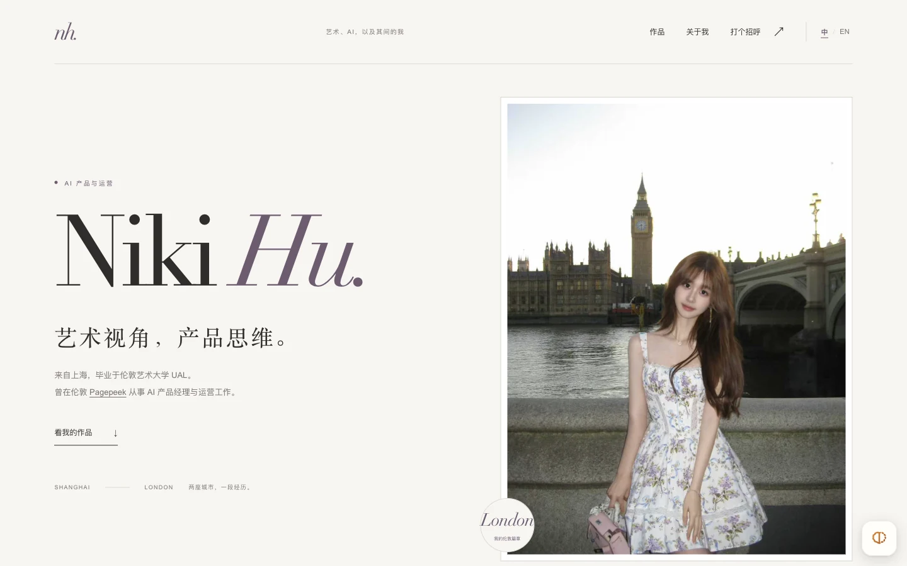

# Niki Hu · Personal Portfolio

中英文个人作品集，连接 AI 产品与运营、创意机器人和交互设计实践。
A bilingual portfolio of AI product work, creative robotics and interactive projects.

[访问网站 / Live](https://nikihu-a.github.io/) · [精选作品 / Projects](https://nikihu-a.github.io/#work) · [GitHub 主页](https://github.com/Nikihu-a)



## 项目概览

- **访客**：希望了解 Niki 的经历、项目与合作方向的人。
- **目标**：从一页介绍进入作品详情，清楚区分工作案例、团队原型与个人探索。
- **内容与方向**：Niki 的个人经历、项目选择与展示方向；网站实现通过 AI 编程协作完成。
- **设计取舍**：使用轻量静态页面、页内详情与中英文切换，作品图片本地托管，演示视频手动播放。

## 精选案例

| 项目 | 展示内容 |
| :--- | :--- |
| [Pagepeek](https://nikihu-a.github.io/#/pagepeek) | AI 产品与运营经历中的产品传播、社交内容与活动资料 |
| [音频响应粒子实验](https://nikihu-a.github.io/#/audio-particles) | TouchDesigner 声音分析、频段映射、节点与粒子渲染 |
| [Memories in the Ashes](https://nikihu-a.github.io/#/ashes) | TouchDesigner 与 Arduino 距离交互、粒子视觉及装置演示 |
| [Lost Crab & Little Flower](https://nikihu-a.github.io/#/lost-crab) | 机器学习与 Arduino 团队机器人项目，正文注明个人贡献 |
| [Dream Printer](https://nikihu-a.github.io/#/dream-printer) | 梦境记录、解释与打印输出的床边设备概念 |
| [LINK](https://nikihu-a.github.io/#/link) | VR 社交与共同游玩的场景设计概念 |

## 本地查看

直接在浏览器打开 `sample/index.html`，无需安装依赖或构建。
也可以使用本地服务器：

```sh
python3 -m http.server 8000 --directory sample
```

打开 <http://localhost:8000>。修改后刷新；如显示旧内容，强制刷新浏览器。

## 文件结构

```text
sample/
├── index.html             # 首页、关于与联系区
├── css/portfolio.css      # 作品区和详情样式
├── js/
│   ├── language.js        # 中英文文案与语言切换
│   ├── projects-data.js   # 作品数据
│   └── portfolio.js       # 卡片、详情与返回交互
└── assets/                # 照片、作品图片与演示视频
docs/                      # 项目预览与维护说明
tools/                     # 离线素材提取与压缩
.github/workflows/         # GitHub Pages 发布
```

## 功能与验证

中英文切换会记住语言选择；作品支持直接分享链接、Escape 关闭、焦点恢复及浏览器返回。页面适配手机，支持系统减少动态效果偏好。

已检查桌面与 375px 手机宽度、六组作品详情、中英文切换、图片路径与视频默认暂停。GitHub Actions 负责发布，线上文件与本地版本按哈希核对。

## 发布与维护

推送 `main` 后，GitHub Actions 自动将 `sample/` 发布到 GitHub Pages，无需 `dist` 或打包步骤。

作品更新、素材重建、缓存版本与署名规则见 [维护说明](docs/maintenance.md)。
